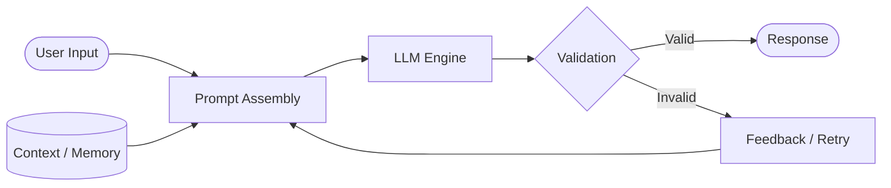
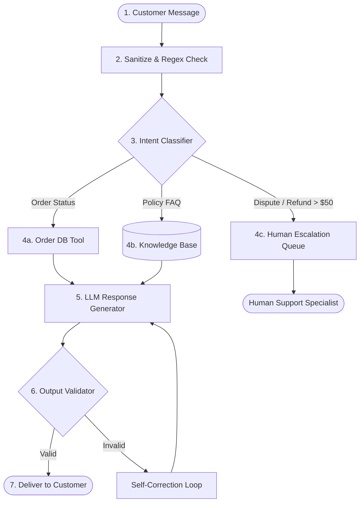

# AI System Design: Architecture, Patterns, and Agentic Workflows

Welcome to the **AI System Design** tutorial.

In [Foundations](../1-foundation), you learned to call LLMs and validate structured outputs. In production, raw API calls are not enough. Reliable AI applications require intentional architecture: combining deterministic code, software design patterns, and agentic workflows to build fast, cost-effective, and fault-tolerant systems.

---

## Table of Contents
1. [Introduction to AI System Design](#1-introduction-to-ai-system-design)
2. [Types of AI Systems](#2-types-of-ai-systems)
3. [Deterministic Logic vs. AI](#3-deterministic-logic-vs-ai)
4. [Core Building Blocks of LLM Systems](#4-core-building-blocks-of-llm-systems)
5. [Software Design Patterns for AI](#5-software-design-patterns-for-ai)
6. [AI Workflows vs. AI Agents](#6-ai-workflows-vs-ai-agents)
7. [AI Agent Frameworks](#7-ai-agent-frameworks)
8. [Understanding Framework Internals](#8-understanding-framework-internals)
9. [Cognitive Architecture](#9-cognitive-architecture)
10. [End-to-End AI System Design](#10-end-to-end-ai-system-design)
11. [Learning Resources](#11-learning-resources)
12. [Wrap-Up & Practice](#12-wrap-up--practice)

---

## 1. Introduction to AI System Design

**AI System Design** is the engineering discipline of combining probabilistic foundation models (LLMs) with deterministic software engineering.

### Why AI Engineers Need It
- **LLMs are non-deterministic:** The same input can yield different outputs; systems require guardrails and output validation.
- **LLMs are slow and expensive:** Every token adds latency and cost; smart architecture minimizes calls.
- **LLMs are stateless:** Models retain no memory; systems must manage databases, sessions, and context windows.

> **Rule of Thumb:** Production AI is **80% traditional software engineering** (APIs, caching, data stores) and **20% model orchestration**.

---

## 2. Types of AI Systems

1. **Document Processing:** Extracts structured fields from unstructured documents (e.g., invoice parsers).
2. **Personal Assistants:** Conversational bots managing multi-turn dialog and tasks (e.g., support chatbots).
3. **Content Generation:** Synthesizes structured copy, code, or summaries (e.g., automated release notes).
4. **Backend Automation:** Event-driven background tasks without a UI (e.g., ticket triage and routing).
5. **Multi-Agent Systems:** Specialized autonomous agents collaborating on complex workflows (e.g., coder + QA).

---

## 3. Deterministic Logic vs. AI

> **Golden Rule:** Effective AI systems use as little AI as possible.

Pure code (Python) is instantaneous, free ($0.00), and 100% predictable. LLMs are slow, costly, and probabilistic.

| Requirement | Use Python (Deterministic) | Use LLM (Probabilistic) |
| :--- | :--- | :--- |
| **Math & Finance** | `refund = round(price * 0.15, 2)` | Explaining fee policies politely |
| **Input Validation** | Regex email checks, checking order IDs | Extracting intent from ambiguous slang |
| **Business Rules** | `if status == 'canceled': halt()` | Classifying freeform user sentiment |

```python
# Customer Support: Python executes logic; LLM handles natural language
def issue_refund(order_id: str, amount: float, reason: str) -> str:
    if amount <= 0 or not order_id.startswith("ORD-"):
        return "Invalid refund parameters."
    net_refund = round(amount * 0.85, 2)  # 15% restocking fee via Python math
    return call_llm(f"Politely explain ${net_refund} refund for {reason}")
```

---

## 4. Core Building Blocks of LLM Systems

1. **Inputs:** User requests, metadata, and files.
2. **Prompts:** Persona instructions, task constraints, and few-shot examples.
3. **Context Window:** Token workspace holding prompts, memory, and retrieved docs.
4. **Outputs:** Structured JSON, tool calls, or generated text.
5. **Feedback Loops:** Retries upon validation failure, caching, and evaluation.



---

## 5. Software Design Patterns for AI

### 1. Chain of Responsibility
Passes requests sequentially through handlers (Guardrail $\rightarrow$ Cache $\rightarrow$ LLM). Ideal for safety filters and spam checks.

```python
class Handler:
    def __init__(self, succ=None): self.succ = succ
    def handle(self, req: str) -> str:
        return self.succ.handle(req) if self.succ else f"AI Answer: {req}"

class SpamGuard(Handler):
    def handle(self, req: str) -> str:
        if "free cash" in req.lower(): return "Blocked: Spam detected."
        return super().handle(req)

pipeline = SpamGuard(succ=Handler())
```

### 2. Strategy Pattern
Swaps models or resolution logic dynamically at runtime based on task complexity.

```python
class FastFaqStrategy:
    def resolve(self, q: str) -> str: return "Instant FAQ reply (0 tokens)."

class ReasoningStrategy:
    def resolve(self, q: str) -> str: return "Calling reasoning LLM for dispute..."

class SupportRouter:
    def __init__(self, strategy): self.strategy = strategy
    def answer(self, q: str) -> str: return self.strategy.resolve(q)
```

### 3. Facade Pattern
Hides classification, retrieval, LLM synthesis, and validation behind a unified interface.

```python
class SupportFacade:
    def handle_ticket(self, user_id: str, message: str) -> str:
        intent = classify_intent(message)       # 1. Classify
        docs = search_kb(intent)                # 2. Retrieve info
        reply = call_llm(message, docs)         # 3. Generate
        return validate_output(reply)           # 4. Validate
```

---

## 6. AI Workflows vs. AI Agents

- **AI Workflow:** A deterministic pipeline (DAG) where code controls execution order (Step A $\rightarrow$ Step B $\rightarrow$ Step C). Predictable, fast, and cost-effective.
- **AI Agent:** A dynamic loop where the LLM evaluates state, selects tools, and iterates until its goal is completed.

### Core Concepts
- **Orchestration:** Managing execution flow and state transitions.
- **Tools:** Python functions called by the model (e.g., `lookup_order(id)`).
- **State:** Shared data dictionary holding turn history and tool results.
- **Routing:** Directing requests to specialized prompts or handlers.
- **Retries:** Catching invalid outputs and prompting the model for fixes.
- **Human-in-the-Loop (HITL):** Halting automation for human sign-off on sensitive actions (e.g., refunds over $100).

---

## 7. AI Agent Frameworks

| Framework | What It Does | When to Use It |
| :--- | :--- | :--- |
| **LangChain** | Large ecosystem of connectors, prompt templates, and parsers. | Rapid prototyping, standard prompt chains, simple RAG. |
| **LangGraph** | Graph-based state machine with cycles, persistence, and branching. | Complex cyclical workflows, multi-agent loops, HITL approval. |
| **PydanticAI** | Type-safe, minimalist agent framework built around Pydantic. | Production services prioritizing strict typing, speed, and simplicity. |

---

## 8. Understanding Framework Internals

Frameworks are simple Python abstractions over foundational primitives:
- **LLM Client:** HTTP request wrapper for model APIs.
- **Prompts:** Parameterized f-strings.
- **Tools:** Python functions with descriptive docstrings.
- **Router / Workflow:** Standard `if/elif` statements checking state.

```python
# Minimal Customer Support Agent in pure Python
def query_db_tool(order_id: str) -> str:
    """Tool: Returns live shipping status."""
    return f"Order {order_id} is in transit, arrives tomorrow."

def run_agent(user_message: str):
    state = {"query": user_message, "route": None, "reply": None}
    msg = state["query"].lower()
    
    if "order" in msg:
        state["route"] = "order_tool"
        state["reply"] = query_db_tool("ORD-9821")     # Tool execution
    elif "refund" in msg:
        state["route"] = "escalate"
        state["reply"] = "Escalated to human support." # Escalation
    else:
        state["route"] = "llm"
        state["reply"] = "AI Response: How can I help you today?"
    return state
```

---

## 9. Cognitive Architecture

**Cognitive Architecture** is the visual blueprint describing how data, decisions, tools, and models interact across an AI application.

To design an architecture:
1. Map entry points, sanitizers, and safety checks.
2. Route queries by intent (FAQ, tool lookup, or human escalation).
3. Connect deterministic tool execution and knowledge retrieval.
4. Validate outputs before final delivery.

### Customer Support Assistant Architecture


---

## 10. End-to-End AI System Design

Execute this 6-step design process before writing application code:

1. **Define Objective & Constraints:** Specify latency limits (< 2s), token budgets, and quality thresholds.
2. **Isolate Deterministic vs. AI Logic:** Map all math, string validation, and DB lookups to pure Python.
3. **Design State & Contracts:** Define explicit Pydantic schemas for inputs, tool payloads, and outputs.
4. **Equip Tools & Enforce Least Privilege:** Provide narrow, read-only tools by default; require authorization for write actions.
5. **Add Safety, Guardrails & Escalation:** Configure input filters, schema validators, and human-in-the-loop triggers.
6. **Plan Observability:** Track latency, token expenditures, error rates, and user resolution metrics.

---

## 11. Learning Resources

### 📺 Video Tutorials
- [Effective AI Systems](https://youtu.be/tx5OapbK-8A)
- [Core Building Blocks](https://youtu.be/T1Lowy1mnEg)
- [PydanticAI](https://youtu.be/zcYtSckecD8)
- [Simplified Framework Implementation](https://youtu.be/bZzyPscbtI8)

### 📚 Official Documentation & Patterns
- [LangChain](https://docs.langchain.com/oss/python/learn)
- [LangGraph](https://docs.langchain.com/oss/python/langgraph/overview)
- [PydanticAI](https://ai.pydantic.dev/)
- [Chain of Responsibility](https://refactoring.guru/design-patterns/chain-of-responsibility)
- [Strategy Pattern](https://refactoring.guru/design-patterns/strategy)
- [Facade Pattern](https://refactoring.guru/design-patterns/facade)
- [Mermaid](https://mermaid.js.org/syntax/flowchart.html)

---

## 12. Wrap-Up & Practice

### Key Takeaways
- **Least AI Principle:** Execute math, validation, and database queries in pure Python; reserve LLMs for unstructured language tasks.
- **Defensive Design:** Always validate model responses with Pydantic schemas and supply fallback paths.
- **Workflows Over Agents:** Default to predictable workflows; use autonomous agent loops only when dynamic tool exploration is required.
- **Modular Patterns:** Apply Chain of Responsibility for safety, Strategy for model selection, and Facade for orchestrating subsystems.

### Hands-On System Design Exercise
> **Challenge: Design an AI Flight Booking & Support System**
> 1. **Partition Logic:** List 2 operations requiring pure Python (e.g., seat pricing calculation, booking ID regex) and 1 requiring an LLM (e.g., flight recommendations).
> 2. **Draw Architecture:** Draft a Mermaid diagram with message intake, intent classification, DB lookup, validation, and human escalation.
> 3. **Human Escalation:** Define 2 conditions requiring human intervention (e.g., flight cancellations, refunds > \$200).
> 4. **Workflow vs. Agent:** Decide whether to use a deterministic workflow or an agent, and justify your choice.

### Self-Assessment Checklist
- [ ] I can determine when to use Python logic instead of an LLM.
- [ ] I understand the core building blocks: inputs, prompts, context, outputs, and feedback loops.
- [ ] I can apply the Chain of Responsibility, Strategy, and Facade patterns to AI architectures.
- [ ] I can explain the distinction between deterministic workflows and autonomous agents.
- [ ] I understand when to choose LangChain, LangGraph, or PydanticAI.
- [ ] I can implement basic agent routing and tool calls in plain Python.
- [ ] I can draw cognitive architecture diagrams using Mermaid syntax.
- [ ] I can apply the 6-step system design process before writing code.

### What You Should Be Able to Do Now
You can now architect complete, production-ready AI systems on paper: decomposing user requirements into deterministic code and LLM calls, diagramming cognitive architectures, specifying data contracts, and selecting the right agent framework.
