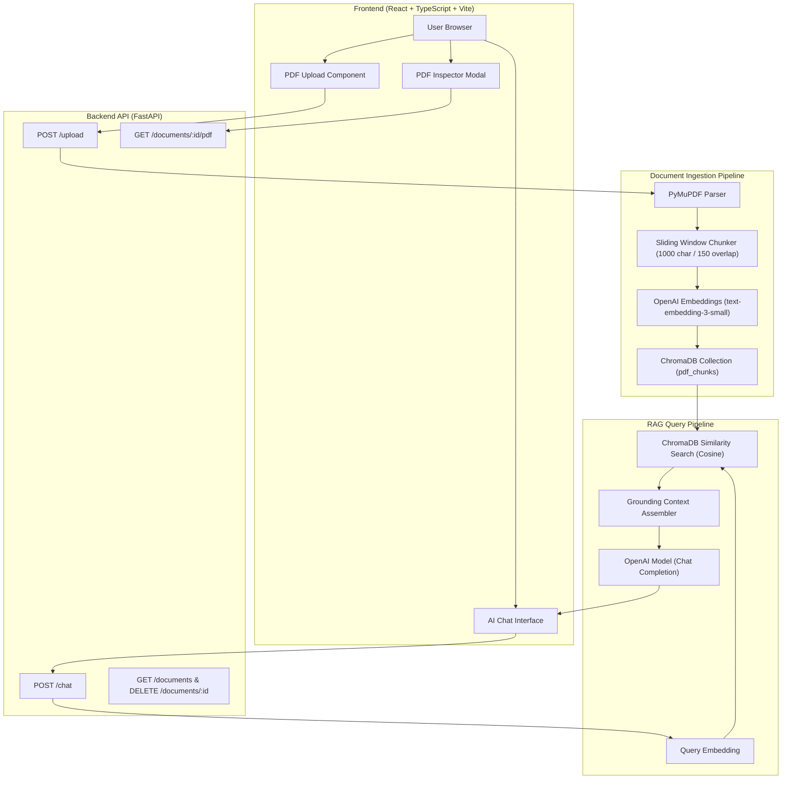
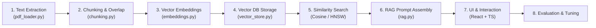

# 📚 PDF Chatbot: Learn Retrieval-Augmented Generation (RAG) from Scratch

> A free, public educational project designed to help developers, students, and AI practitioners understand how to build a production-ready, full-stack **Retrieval-Augmented Generation (RAG)** application from the ground up.

---

## 1. Project Introduction

### What is PDF Chatbot?
**PDF Chatbot** is an interactive, full-stack question-answering system. It allows you to upload any text-based PDF document, automatically breaks the document into bite-sized semantic chunks, converts those chunks into high-dimensional vector embeddings, stores them in a local vector database (**ChromaDB**), and lets you ask questions in natural language.

An AI model (**OpenAI GPT**) answers your questions using **only the facts found in your document**, providing direct source references with exact page numbers.

### What Problem Does It Solve?
1. **Large Document Ingestion**: Standard Large Language Models (LLMs) have context window limits and cannot read hundreds of pages of documentation efficiently or economically.
2. **Hallucination Prevention**: General LLMs often guess or make up convincing but incorrect answers. RAG constrains the model by injecting retrieved relevant text into the prompt as verified ground truth.
3. **Data Freshness & Privacy**: Your custom documents do not need to be used to fine-tune or train models. The vector store operates locally, allowing immediate updates when files are added or deleted.

### What You Will Learn
By exploring this repository, you will learn the complete RAG engineering lifecycle:
- How to parse PDF documents and extract clean text using **PyMuPDF**.
- How sliding-window text chunking with overlap prevents context fragmentation.
- How to generate vector representations with OpenAI's `text-embedding-3-small`.
- How to initialize, query, and manage a persistent local vector database using **ChromaDB**.
- How cosine similarity search identifies the most relevant document sections.
- How to author system instructions that enforce source attribution (`[Source 1]`, `[Source 2]`).
- How to build a modern, responsive user interface using **React**, **TypeScript**, **Vite**, and **Tailwind CSS**.
- How to implement cascading deletion of documents, local files, and vector indices.

> **Note**: This repository is **100% free to explore, study, clone, and use as a learning foundation**.

---

## 2. Features

- **Drag-and-Drop PDF Upload**: Upload PDF files up to 20 MB with real-time format validation.
- **Fast Text Extraction**: Efficient PDF parsing powered by PyMuPDF (`pymupdf`).
- **Sliding-Window Chunking**: Configurable chunk size (1,000 characters) and overlap (150 characters) to preserve contextual boundaries.
- **Dense Vector Embeddings**: Batch embedding generation with OpenAI's `text-embedding-3-small` (1,536 dimensions).
- **Persistent Vector Storage**: Local ChromaDB collection using HNSW indexing and cosine similarity.
- **Document-Scoped or Global Retrieval**: Query against a single active PDF or search across all uploaded documents simultaneously.
- **Verifiable Source Citations**: Answers include references with original PDF filename, page number, and quote excerpts.
- **Interactive PDF Viewer**: Embedded modal viewer that opens the original PDF jumped directly to the cited page.
- **Document Management**: Document library displaying page count, chunk count, file size, and timestamps, with cascading deletion of vectors and files.
- **Modern Responsive UI**: Built with React, TypeScript, and Tailwind CSS, featuring an AI chat interface inspired by ChatGPT and NotebookLM.

---

## 3. Technology Stack

### Backend
- **Python (>= 3.13)**: Core programming language.
- **FastAPI**: High-performance asynchronous web framework for building APIs.
- **uv**: Extremely fast Python package and project manager.
- **PyMuPDF (`pymupdf`)**: High-speed PDF text parsing and extraction engine.
- **ChromaDB (`chromadb`)**: Open-source, embedded, persistent vector database.
- **OpenAI Python SDK**: Interfaces for generating embeddings and chat completions.
- **Uvicorn**: ASGI web server implementation.
- **Pydantic**: Data validation and type enforcement.
- **python-dotenv**: Environment configuration management.

### Frontend
- **React 19**: Modern component-based user interface library.
- **TypeScript**: Static typing for maintainability and safety.
- **Vite**: Ultra-fast frontend build tool and dev server.
- **Tailwind CSS**: Utility-first CSS framework for clean, responsive design.
- **Lucide React**: Clean, accessible iconography.
- **Vitest**: Unit testing framework for frontend services.

---

## 4. Architecture & RAG Pipeline

### High-Level Architecture Diagram



### How the Pipeline Works

#### Phase 1: Ingestion Pipeline
1. **Upload**: A user uploads a PDF file via the frontend dropzone.
2. **Text Extraction**: The backend saves the file to `uploads/{document_id}.pdf` and uses PyMuPDF to extract text from each page along with the page number.
3. **Sliding-Window Chunking**: The extracted text is split into chunks of up to 1,000 characters, overlapping by 150 characters with preceding chunks so sentences that span boundaries remain understandable.
4. **Vector Embedding**: Chunks are sent in batches to the OpenAI Embeddings API (`text-embedding-3-small`), converting each text snippet into a 1,536-dimensional vector.
5. **Storage**: The vector, text, and metadata (`document_id`, `filename`, `page_number`, `chunk_index`) are upserted into ChromaDB.

#### Phase 2: Retrieval & Answering Pipeline
1. **Query Embedding**: When the user asks a question, the backend converts the query text into a vector using the same embedding model.
2. **Semantic Search**: ChromaDB searches the `pdf_chunks` collection using cosine distance to find the `top_k` most relevant chunks (optionally filtered by `document_id`).
3. **Context Construction**: The retrieved chunks are formatted with `[Source 1 | File: ... | Page: ...]` header tags.
4. **Constrained Prompting**: A system prompt instructs the OpenAI LLM to answer using **only** the provided text chunks, cite supporting chunks with `[Source X]`, and refuse to speculate if the information is missing.
5. **Citations & Return**: The generated answer and source metadata are returned to the frontend and displayed with interactive citation cards.

---

## 5. Project Structure

```
pdf-chatbot/
├── app/                        # Python FastAPI Backend
│   ├── chunking.py             # Sliding-window text chunking algorithm
│   ├── documents.py            # Local JSON metadata registry & persistence
│   ├── embeddings.py           # OpenAI embedding batching & query embedding
│   ├── main.py                 # FastAPI endpoints (upload, search, chat, docs, health)
│   ├── pdf_loader.py           # PyMuPDF text extraction logic
│   ├── rag.py                  # RAG context builder, prompt rules, and LLM call
│   └── vector_store.py         # Persistent ChromaDB client, upsert & query methods
├── frontend/                   # React + TypeScript Frontend
│   ├── src/
│   │   ├── components/
│   │   │   ├── chat/           # ChatInterface, MessageBubble, ChatInput, SourceCitation
│   │   │   ├── common/         # ErrorBoundary, Toast notification system
│   │   │   ├── dashboard/      # DashboardOverview, QuickStartGuide
│   │   │   ├── documents/      # DocumentList, DocumentCard, PdfViewerModal
│   │   │   ├── layout/         # Navbar, Sidebar, MainLayout
│   │   │   └── upload/         # FileDropzone, UploadProgress, UploadSection
│   │   ├── services/
│   │   │   ├── api.ts          # Centralized API service layer with timeouts
│   │   │   └── api.test.ts     # Unit tests for the frontend API client
│   │   ├── types/
│   │   │   └── index.ts        # Shared TypeScript data models
│   │   ├── App.tsx             # Root application orchestrator
│   │   └── index.css           # Tailwind CSS configuration and theme styling
│   ├── package.json            # Node.js dependencies and scripts
│   ├── tailwind.config.js      # Tailwind CSS configuration
│   └── vite.config.ts          # Vite build and development configuration
├── tests/
│   └── test_backend.py         # Backend integration and unit test suite
├── uploads/                    # Directory for uploaded PDF files (gitignored)
├── vector_db/                  # Persistent ChromaDB vector database (gitignored)
├── .env.example                # Backend environment variable template
├── pyproject.toml              # Python project metadata and dependencies
└── README.md                   # Project documentation
```

---

## 6. Prerequisites

Before running the application locally, ensure you have the following installed:

| Tool | Minimum Version | Purpose | Installation |
|---|---|---|---|
| **Python** | 3.13 or newer | Backend runtime | [python.org](https://www.python.org/) |
| **uv** | Latest | Fast Python package manager | [astral.sh/uv](https://astral.sh/uv) |
| **Node.js & npm** | Node 18+ (Node 20+ recommended) | Frontend runtime | [nodejs.org](https://nodejs.org/) |
| **Git** | Latest | Version control | [git-scm.com](https://git-scm.com/) |
| **OpenAI API Key** | Active account | Embedding & LLM API access | [platform.openai.com](https://platform.openai.com/) |

---

## 7. Complete Local Setup Instructions

Follow these step-by-step instructions to get the application running on your local machine.

### Step 1: Clone the repository
```bash
git clone <repository-url>
cd pdf-chatbot
```

### Step 2: Set up the Python virtual environment using uv
```bash
# Create a virtual environment using Python 3.13+
uv venv

# Activate the virtual environment
# On Windows (PowerShell):
.venv\Scripts\Activate.ps1

# On macOS / Linux:
source .venv/bin/activate
```

### Step 3: Configure backend environment variables
Create your `.env` file by copying the example template:
```bash
# On Windows (PowerShell):
Copy-Item .env.example .env

# On macOS / Linux:
cp .env.example .env
```
Open `.env` in your text editor and add your OpenAI API key:
```env
OPENAI_API_KEY=sk-proj-yourActualKeyHere
CHAT_MODEL=gpt-4o-mini
EMBEDDING_MODEL=text-embedding-3-small
```

### Step 4: Install backend dependencies
Install the required Python packages into your active virtual environment:
```bash
uv pip install -r pyproject.toml
# Or sync directly using uv:
uv sync
```

### Step 5: Start the FastAPI development server
```bash
uvicorn app.main:app --reload --port 8000
```
Verify the backend is running by opening:
- API Home: [http://localhost:8000](http://localhost:8000)
- Swagger UI Documentation: [http://localhost:8000/docs](http://localhost:8000/docs)

---

### Step 6: Navigate to the frontend directory
Open a **new terminal window** and navigate into the `frontend` folder:
```bash
cd frontend
```

### Step 7: Install frontend dependencies
```bash
npm install
```

### Step 8: Configure frontend environment variables
Copy the frontend environment template:
```bash
# On Windows (PowerShell):
Copy-Item .env.example .env

# On macOS / Linux:
cp .env.example .env
```
Verify `frontend/.env` contains the correct API base URL:
```env
VITE_API_BASE_URL=http://localhost:8000
```

### Step 9: Start the frontend development server
```bash
npm run dev
```
The console will display your local URL (typically `http://localhost:5173`).

### Step 10: Open the application and test it
1. Open your browser and visit [http://localhost:5173](http://localhost:5173).
2. Go to the **Upload PDF** tab.
3. Drag and drop any text-based PDF file (or click **Browse Files**).
4. Watch the progress indicator as the backend extracts text, chunks it, generates OpenAI embeddings, and stores vectors in ChromaDB.
5. Click **Start Chatting with this Document** (or navigate to the **AI Chat** tab).
6. Type a question related to your PDF and click **Send**.
7. Observe the answer and expand the **Retrieved Sources** chips below the answer to inspect exact page numbers and excerpts.

---

## 8. Environment Variables

### Backend (`.env`)

| Variable | Required? | Default | Description |
|---|---|---|---|
| `OPENAI_API_KEY` | **Yes** | *None* | Your secret OpenAI API key from [platform.openai.com](https://platform.openai.com/api-keys). |
| `CHAT_MODEL` | No | `gpt-4o-mini` | The OpenAI chat completion model used to answer questions (e.g., `gpt-4o-mini`, `gpt-4o`). |
| `EMBEDDING_MODEL` | No | `text-embedding-3-small` | The OpenAI embedding model used to vectorize chunks and search queries (1,536 dimensions). |

### Frontend (`frontend/.env`)

| Variable | Required? | Default | Description |
|---|---|---|---|
| `VITE_API_BASE_URL` | **Yes** | `http://localhost:8000` | The base URL where the FastAPI backend server is accessible. |

> **Security Note**: Never commit `.env` files to version control. Both the root `.gitignore` and `frontend/.gitignore` are configured to prevent secrets from being tracked.

---

## 9. How to Use

### Uploading PDFs
1. Click **Upload PDF** on the sidebar or dashboard.
2. Select or drop a PDF file. The file must contain selectable text and be under 20 MB.
3. The server assigns a unique `document_id` and processes the file into chunks and vector embeddings.
4. After processing, a summary card shows the total pages, chunk count, and embedding dimensions.

### Asking Questions
1. In the **AI Chat** tab, your active document is indicated in the header.
2. Type your question into the chat box and press <kbd>Enter</kbd> (or click the Send button). Use <kbd>Shift</kbd> + <kbd>Enter</kbd> to insert a new line.
3. You can adjust the **Chunks (`top_k`)** selector (3, 5, 8, or 10) to control how many context chunks are retrieved.
4. To ask questions across all uploaded PDFs rather than just one file, select **All Documents (Global)** from the dropdown in the chat header.

### Verifying Source References
1. When an answer is generated, supporting references like `[Source 1]` or `[Source 2]` are highlighted.
2. Below the response, click any source chip to expand and read the exact text excerpt retrieved from ChromaDB.
3. Click the external link icon on any source card to open the built-in PDF viewer directly to that page.

---

## 10. Learning Roadmap

If you are using this repository to learn RAG, here is the recommended study sequence:



1. **PDF Text Extraction** ([app/pdf_loader.py](file:///c:/ai-engineering/4-rag/pdf-chatbot/app/pdf_loader.py)):
   Understand how PyMuPDF opens documents, iterates over pages, checks for encryption, and extracts clean sorted text strings.
2. **Text Chunking & Overlap** ([app/chunking.py](file:///c:/ai-engineering/4-rag/pdf-chatbot/app/chunking.py)):
   Learn why sliding windows with overlap are used. Experiment with different `chunk_size` (e.g. 500 vs 1,000) and `overlap` values (e.g. 100 vs 200).
3. **Embeddings** ([app/embeddings.py](file:///c:/ai-engineering/4-rag/pdf-chatbot/app/embeddings.py)):
   See how batching texts into OpenAI's embedding API converts strings into lists of floats representing semantic meaning.
4. **Vector Databases** ([app/vector_store.py](file:///c:/ai-engineering/4-rag/pdf-chatbot/app/vector_store.py)):
   Understand how ChromaDB creates a persistent collection, configures HNSW index spaces (`cosine`), and performs upserts.
5. **Similarity Search & Filtering**:
   Study how `collection.query()` computes distances and filters by metadata (such as `document_id`).
6. **Prompt Engineering & Grounding** ([app/rag.py](file:///c:/ai-engineering/4-rag/pdf-chatbot/app/rag.py)):
   Review the instructions provided to the LLM to prevent hallucinations, cite sources, and treat user documents as untrusted data.
7. **Frontend Architecture** ([frontend/src/](file:///c:/ai-engineering/4-rag/pdf-chatbot/frontend/src)):
   Study how TypeScript interfaces, API services with timeouts, and responsive component hierarchies create a polished user experience.
8. **Evaluation & Optimization**:
   Try measuring answer accuracy, response latency, and chunk retrieval quality. Experiment with reranking models or hybrid keyword search.

---

## 11. Troubleshooting

### 1. Backend Server Fails to Start: "OPENAI_API_KEY is missing from .env"
- **Cause**: The `.env` file does not exist or lacks a valid `OPENAI_API_KEY`.
- **Solution**: Ensure you created a `.env` file in the project root (copied from `.env.example`) and populated `OPENAI_API_KEY=sk-...`.

### 2. "ImportError: DLL load failed while importing cygrpc" (Windows)
- **Cause**: On Windows systems with Smart App Control or Application Control policies enabled, unsigned DLLs bundled with optional OpenTelemetry gRPC exporters may be blocked.
- **Solution**: The project includes fallback guards in ChromaDB's telemetry imports so that the core local persistent vector store operates normally without requiring gRPC telemetry.

### 3. Frontend Shows "Backend: Connecting..."
- **Cause**: The FastAPI server is not running on port 8000, or a firewall/proxy is blocking the connection.
- **Solution**: Verify the backend is active by opening `http://localhost:8000/health` in your browser. Ensure `frontend/.env` has `VITE_API_BASE_URL=http://localhost:8000`.

### 4. "No selectable text found. This may be a scanned PDF."
- **Cause**: The uploaded PDF contains scanned images or photos rather than computer-encoded text.
- **Solution**: Use text-searchable PDFs. PyMuPDF extracts text streams directly; purely image-based PDFs require an optical character recognition (OCR) engine.

### 5. "PDF must be smaller than 20 MB"
- **Cause**: The uploaded file exceeds the configured file size limit in `app/main.py`.
- **Solution**: Upload a smaller document, or adjust `MAX_FILE_SIZE` in `app/main.py` if your hardware and OpenAI budget accommodate larger files.

---

## 12. Running Tests

### Backend Test Suite
Run the unit and integration tests using Python's built-in `unittest` runner:
```bash
# With virtual environment activated:
python -m unittest tests/test_backend.py
```

### Frontend Test Suite
Run the Vitest test suite in the `frontend` directory:
```bash
cd frontend
npm run test
```

### Production Build Verification
Verify the frontend builds without TypeScript or bundling errors:
```bash
cd frontend
npm run build
```

---

## 13. Contributing

Contributions, issues, and feature requests are welcome! If you would like to help improve this educational resource:

1. **Fork the Repository**.
2. **Create a Feature Branch**: `git checkout -b feature/your-feature-name`.
3. **Commit Your Changes**: `git commit -m "feat: add your descriptive feature"`.
4. **Push to the Branch**: `git push origin feature/your-feature-name`.
5. **Open a Pull Request**: Clearly describe your changes and the problem they solve.

If you find a bug or have an idea for a learning topic, feel free to open an Issue on GitHub.

---

## 14. License & Usage

This repository is **publicly available and free to explore, study, and learn from**.

- You are encouraged to clone this repository, experiment with the code, modify the chunking algorithms, test alternative embedding models, and build your own custom RAG projects.
- *Note*: A formal open-source license file (such as MIT or Apache-2.0) has not been added to this repository yet. If you intend to use this code for commercial purposes, please check for updates or reach out to the project maintainers.
